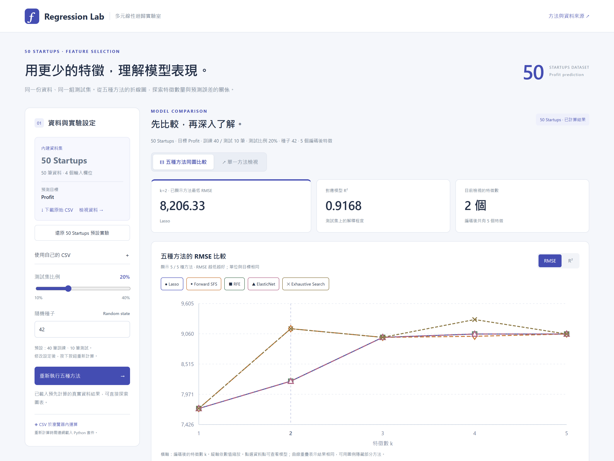
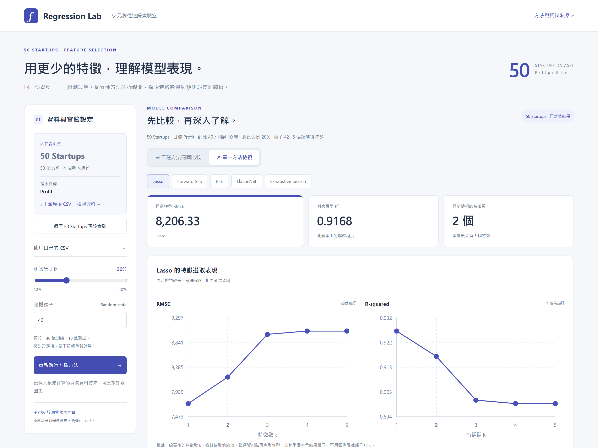
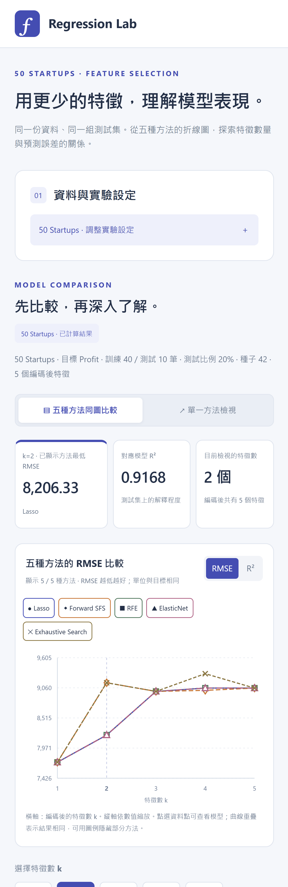

# 50 Startups 多元線性迴歸實驗室

以 50 Startups Dataset 探索特徵數量與利潤預測的關係，比較 Lasso、Forward SFS、RFE、ElasticNet 與 Exhaustive Search 五種特徵選取方法。

開啟網站即可查看預先計算的結果；透過 Web Worker 與 Pyodide 在瀏覽器執行 Python / scikit-learn，可調整設定或使用自己的 CSV。資料不會上傳至分析伺服器。

分析流程：CSV → 資料切分與前處理 → 特徵選取 → LinearRegression → 測試集評估 → 圖表與模型試算。

## 我的專案連結

- **網站網址**：[https://hitomihuang.github.io/DIC2/](https://hitomihuang.github.io/DIC2/)
- **GitHub 儲存庫網址**：[https://github.com/HitomiHuang/DIC2](https://github.com/HitomiHuang/DIC2)

> **作業主題**：運用 AI 輔助開發多元線性迴歸與特徵選取比較網站\
> **專案名稱**：50 Startups 多元線性迴歸實驗室（Regression Lab）\
> **資料來源**：[50 Startups Dataset · Avik Jain / 100-Days-Of-ML-Code](https://github.com/Avik-Jain/100-Days-Of-ML-Code/blob/master/datasets/50_Startups.csv)

## 網站畫面

以下為目前部署網站的實際畫面，以高像素密度擷取並保存為無損 PNG。桌面版原圖為 2880 × 2160，手機版原圖為 1170 × 3600；點選圖片可查看原始尺寸。

### 五種方法同圖比較

### 單一方法檢視

### 手機版

## 網站功能

- 同圖比較：切換 RMSE／R²；以顏色、線型與符號區分五種方法，圖例可開關曲線。
- 各自檢視：選擇單一方法，同時查看 RMSE 與 R² 折線圖。
- 特徵數選擇：切換 k，檢視選取特徵、相同 k 的方法比較及模型係數。
- 利潤試算：依目前選取的 50 Startups 模型即時預測，未使用的欄位會停用。
- 資料與設定：原始 CSV 下載／預覽、自訂 CSV、測試集比例與隨機種子設定。
- 結果匯出：匯出全部方法、全部 k 的結果與評估設定；設定修改後會提示圖表尚未更新。
- 手機與鍵盤操作：窄螢幕收合實驗設定，優先呈現比較圖；圖表資料點支援鍵盤。

五種方法共用相同的訓練／測試資料，選取特徵後皆以 LinearRegression 擬合。曲線重疊代表結果相同；測試集分數只反映本次切分，不能單憑特徵數判定過度擬合。

## 本機預覽

需要 Node.js 18 或以上版本。無 Node 套件依賴，不需要 npm install。

~~~bash
git clone https://github.com/HitomiHuang/DIC2.git
cd DIC2
npm start
~~~

開啟 [http://127.0.0.1:4173/](http://127.0.0.1:4173/)。

也可使用 Python 靜態伺服器：

~~~bash
python -m http.server 4173 --directory dist
~~~

請以 HTTP/HTTPS 使用網站。直接雙擊 HTML 可以查看預先計算的內容，但 Web Worker 重新運算需要 HTTP/HTTPS。首次重新計算需連網下載 Pyodide 與科學運算套件，可能需要 1–2 分鐘；預先計算結果無須等待 Python 載入。

## GitHub Pages 部署

此儲存庫可沿用分支部署，不需新增建置流程：

1. 將更新後的專案檔案推送至 GitHub 的 `main` 分支，包含根目錄的 `index.html`、`.nojekyll` 與完整 `dist/`。
2. 開啟儲存庫 Settings → Pages，Source 選 Deploy from a branch，Branch 選 main，資料夾選 / (root)，按下 Save（若設定相同則不需變更）。
3. 等待 Actions → pages-build-deployment 最新部署成功，再開啟 [部署首頁](https://hitomihuang.github.io/DIC2/)。首頁會自動導向 `dist/` 應用程式。

根目錄原先沒有 `index.html`，因此從根目錄部署時會由 Jekyll 將 README 產生成首頁。新增入口後，首頁會開啟互動程式；`.nojekyll` 讓 Pages 直接發布靜態檔案。若仍看到舊頁面，請先確認最新部署成功，再重新整理或使用無痕視窗。

網站為純靜態檔案。部署到其他平台時，也可以將 dist 內容作為網站根目錄，保留 worker.js、engine.py 與 CSV 的相對路徑。重新計算需能存取 cdn.jsdelivr.net。

## 資料與模型設定

內建資料為 50 家公司的 R&D Spend、Administration、Marketing Spend、State 與 Profit，預測目標為 Profit。State 以 California 為基準做 One-hot 編碼，編碼後共有 5 個特徵。

- 預設切分：40 筆訓練、10 筆測試，test_size=0.2、random_state=42。
- 比較範圍：特徵數 k=1…5，五種方法共 25 組結果。
- 前處理：以訓練集擬合補值、標準化與類別編碼；測試集不參與訓練或特徵選取。
- 最終模型：選取特徵後重新擬合含截距的 LinearRegression。

預設切分下，五種方法在 k=1 都選取 R&D Spend，RMSE 約 7,714.33、R² 約 0.926511。畫面起始選取 k=2 是為方便比較方法，不代表 k=2 最佳。

Forward SFS 與 Exhaustive Search 使用訓練集三折交叉驗證選取特徵。目前內層 CV 共用外層訓練集擬合的前處理；含缺值的自訂資料若需嚴格模型選擇，應改為各 fold 獨立擬合的 Pipeline。完整規則、指標公式與限制見[模型設定與驗證紀錄](docs/model-validation.md)。

自訂 CSV 最大 2 MB，需有 20–3,000 筆有效目標值、1–30 個輸入欄位，編碼後最多 10 個特徵。缺失或非有限的目標值會排除；請移除流水號或高基數類別欄位，以控制完整搜尋的計算成本。

## 驗證

建議先建立並啟用 Python 虛擬環境，再執行：

~~~bash
python -m pip install -r requirements.txt
python verify_calculations.py
python qa-engine.py
npm test
~~~

verify_calculations.py 另外以 NumPy 實作特徵選取與指標核對；qa-engine.py 檢查缺值、類別編碼、固定種子、係數與無效資料。npm test 使用 DOM 替身檢查介面邏輯，不能取代實際瀏覽器測試。

專案原有的 2026-10-14 驗證紀錄顯示，25 組特徵集合全部一致，NumPy 重算指標最大絕對差約 1.82 × 10⁻¹¹。詳細結果與原驗證環境見[模型設定與驗證紀錄](docs/model-validation.md)，原始輸出保留於[稽核 JSON](docs/calculation-audit.json)與[驗證結果 CSV](docs/verified-results.csv)。

若需重新產生預設結果，執行 python prepare-defaults.py 後，再執行 python verify_calculations.py。

## 資料來源

- [50 Startups Dataset · Avik Jain / 100-Days-Of-ML-Code](https://github.com/Avik-Jain/100-Days-Of-ML-Code)
- [介面與功能參考：50 Startups Multiple Linear Regression Explorer](https://huanchen1107.github.io/AIoT-DIC2-MultipleLR/)
- [scikit-learn 特徵選取](https://scikit-learn.org/stable/modules/feature_selection.html)
- [Pyodide 0.27.7](https://pyodide.org/en/0.27.7/usage/quickstart.html)
